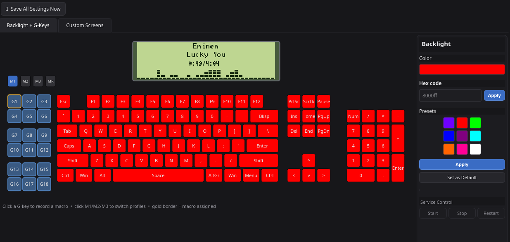

# Logitech G510s for Linux


**The LCD screen, RGB backlight and G-key macros of the Logitech G510 /
G510s, properly working on Linux.** Logitech's own software is
Windows-only and everything else out there is old, abandoned or
half-broken, so this talks to the keyboard directly.



## What you get

- **Live stats on the LCD** — CPU, RAM, VRAM and temperature, plus an
  analog clock on L1.
- **Custom screens** — drag sensors, images, text and a visualizer onto
  L2–L5 in a live editor that shows exactly what the LCD will.
- **A little Winamp on your keyboard** — equalizer bars for whatever's
  playing, plus the song title, artist and elapsed time.
- **RGB backlight** colour and brightness, restored on every boot and
  replug.
- **G-key macros** (G1–G18) on three profiles (M1/M2/M3): recorded
  keystrokes or shell commands.
- **Runs as your normal user** as three small background services,
  starts at login, and survives unplugging the keyboard or its headset.

## Install

```
git clone https://github.com/grumpybollocks/Logitech-G510s-LCD-control.git
cd Logitech-G510s-LCD-control
./install.sh
```

The installer shows what's already installed and what it will add
before touching anything, builds the LCD programs, converts the label
fonts, sets up the udev rules and services, and adds desktop
shortcuts. It asks for your `sudo` password once, and for one
unplug/replug of the keyboard so the new rules take effect. Safe to
re-run any time.

**Check it worked:**

```
systemctl --user status g510-lcd-stats g510-lcd-buttons g510-macro-daemon
```

All three should say `active (running)`. If the LCD stays blank,
unplug and replug the keyboard once.

### What your PC needs

| | |
| --- | --- |
| **Linux** | An Arch-based distro (Arch, Manjaro, EndeavourOS, Garuda…). The installer uses `pacman` and an AUR helper (`yay` or `paru` — install one first). On other distros the programs run, but you'd install the dependencies and do the installer's steps by hand (`libg15`/`libg15render` from source). |
| **Keyboard** | Logitech G510 or G510s, with or without a headset plugged in. |
| **Kernel** | A recent one: the keyboard uses the kernel's own `hid-lg-g15` driver, and colour control needs `/sys/class/leds/g15::kbd_backlight/multi_intensity` (developed on 7.x). |
| **Permissions** | Your user in the `input` group. The installer adds you if needed — log out and back in afterwards. |
| **Audio** | PipeWire (with `pipewire-pulse`) for the visualizer. |
| **Desktop** | Anything. Two of the desktop shortcuts open `konsole`/`dolphin` (KDE); edit those two elsewhere. |

What the installer adds, and why:

| Package | For |
| --- | --- |
| `python-pyqt5`, `python-pillow`, `python-evdev` | the app, image import, reading the G-keys |
| `ydotool` | replaying macro keystrokes |
| `freetype2` | the LCD's label font |
| `playerctl` | song title / artist / time for the media sensors |
| `zenity` | the "restarted" popup from the Start shortcut |
| `libg15`, `libg15render` (AUR) | the LCD drawing library everything is built on |

## Sensors: what shows up on which hardware

Sensors are found by driver name, so most PCs need no setup. To see
what was picked on yours:

```
src/g510_lcd_stats --sensors
```

| LCD reading | Works on | Otherwise |
| --- | --- | --- |
| CPU temp | AMD (`k10temp`, `zenpower`), Intel (`coretemp`), ARM / Raspberry Pi (`cpu_thermal`); falls back to the `x86_pkg_temp` thermal zone | N/A |
| GPU temp | AMD (`amdgpu`, `radeon`), NVIDIA proprietary driver (via NVML), NVIDIA `nouveau`, Intel Arc (`xe`) | N/A — Intel integrated graphics have no temperature sensor |
| GPU hotspot temp | AMD (`amdgpu`) | N/A |
| GPU VRAM temp | AMD (`amdgpu`), Intel Arc (`xe`) | N/A |
| GPU load, VRAM used | AMD (`amdgpu`), NVIDIA proprietary driver | N/A |
| Motherboard temps (`MB_TEMP1`–`8`) | Gigabyte (`gigabyte_wmi`), ASUS (`asus_wmi_sensors`, `asus-ec-sensors`), most other boards via their Nuvoton `nct67xx`/`nct66xx`, ITE `it87xx`, Winbond or Fintek chip; Dell, ThinkPad, HP laptops | N/A |
| CPU load/clock, RAM, swap, disk, network, uptime, media | every Linux PC | — |

- **Two graphics cards** (e.g. a Ryzen APU plus a real card): the one
  with the most VRAM is used; with several NVIDIA cards, the first.
- **NVIDIA:** its driver has no Linux sensor files, so readings come
  from `libnvidia-ml` (ships with the driver), loaded only when an
  NVIDIA driver is running.
- **Laptops with a switchable GPU:** a sleeping GPU is left asleep and
  shows N/A instead of being woken up.
- **Motherboard sensors missing?** Many boards need their sensor driver
  loaded: run `sudo sensors-detect` (from `lm_sensors`) and load what it
  suggests, often `sudo modprobe nct6775`. Some ITE chips need the
  out-of-tree `it87` driver from the AUR.
- So far only AMD hardware has been checked on a real machine. Intel,
  NVIDIA and the rest are covered by tests against simulated sensor
  trees. Reports from other hardware are welcome — include the
  `--sensors` output.

## The audio visualizer

Drop a visualizer onto any of L2–L5 and the LCD becomes a tiny live
equalizer next to the song title, artist and a running `1:23/3:45`.

It doesn't hook into any particular app: it listens to whatever is
coming out of your speakers, like a real VU meter. So it works the same
with Spotify, a YouTube tab, VLC or a game, with nothing to configure.
Make it bigger and it adds more bars rather than fatter ones.

It only listens while a screen with a visualizer is actually on the
LCD; on the stats or clock screen the audio capture and song lookups
stop completely.

## How it works

Three small programs run as systemd `--user` services:

| Service | Does |
| --- | --- |
| `g510-lcd-stats` (C) | draws every LCD screen and sends it to `/dev/g510-lcd` |
| `g510-lcd-buttons` (C) | listens to L1–L5 on `/dev/g510-keys` and switches screens |
| `g510-macro-daemon` (Python) | listens to G1–G18 and M1–M3 and replays macros through `ydotool` |

The app (`src/g510_app.py`) is the editor: backlight, macros and the
Custom Screens builder. Its previews are rendered by the same C
program that drives the LCD, so they match the real screen pixel for
pixel.

`/dev/g510-lcd` and `/dev/g510-keys` are stable links made by the udev
rule in `udev/`, not device numbers that change between boots. The
keyboard drops off USB and comes back whenever its headset jack is
plugged or unplugged; everything reconnects on its own.

Run the tests with `tests/run-tests.sh` — nothing in them touches your
keyboard or your saved settings.

## Status

- Public, MIT-licensed, in daily use on the developer's own G510s.
- Changes land on `main` through pull requests and are confirmed on
  the real keyboard.
- Not on the AUR yet (a PKGBUILD lives in `packaging/`).

## Docs

- [`G510_README.md`](G510_README.md) — the full story: protocol
  details, every bug hit and fixed, fonts, udev rules.
- [`G510_CUSTOM_SCREENS_HOWTO.md`](G510_CUSTOM_SCREENS_HOWTO.md) — how
  to use the Custom Screens editor.
- [`BRANCHES.md`](BRANCHES.md) — branch history.

**Looking for the G910?** That app moved to its own repo:
[grumpybollocks/g910-control](https://github.com/grumpybollocks/g910-control).

---

## The cheeky bits

- The LCD can show free space on a second drive like any other sensor —
  fully optional, and it shows "N/A" gracefully if you don't have one.
- This started out sharing a repo with the G910 app before the two
  split; that history still lives in this repo's commit log.
- "wtf are the blue squares for?" is genuine, verbatim user feedback
  that shipped a real UI fix (resize handles now only appear when you
  hover near them) — real usage beats guessing every time.

## License

[MIT](LICENSE).
