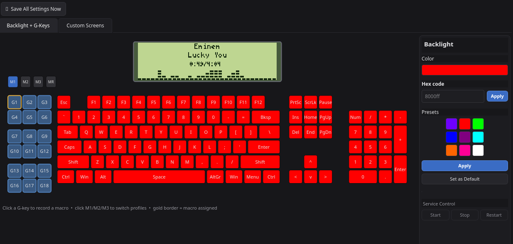

# Logitech G510s – Software


**Ein von Grund auf entwickelter Linux-Treiber mit grafischer Oberfläche für die Logitech G510s** – mit funktionierendem LCD, Hintergrundbeleuchtung und G-Tasten-Makros. Logitechs eigene Software gibt es nur für Windows; andere Lösungen sind veraltet, verlassen oder unvollständig. Dieses Projekt kommuniziert deshalb direkt mit dem USB-/HID-Protokoll der Tastatur.

## Herunterladen und installieren

```sh
git clone https://github.com/grumpybollocks/Logitech-G510s-LCD-control.git
cd Logitech-G510s-LCD-control
./install.sh
```

`install.sh` kümmert sich um alle Abhängigkeiten. Das Skript meldet jeweils, was bereits installiert ist und was noch hinzukommt – `pacman` wird nie still im Hintergrund ausgeführt. Außerdem baut es den LCD-Treiber, konvertiert die Beschriftungsschriftart, richtet die systemd-Dienste ein und erstellt Desktop-Verknüpfungen. Das Skript kann gefahrlos erneut ausgeführt werden. Einmalig werden das `sudo`-Passwort (für udev-Regeln und Paketinstallationen) und das Ab- und erneute Anstecken der Tastatur benötigt, damit die Regeln wirksam werden.

Installierte Pakete und ihre Aufgaben:

| Paket | Verwendung |
| --- | --- |
| `python-pyqt5`, `python-pillow`, `python-evdev` | Grafische Oberfläche, Bildimport und Auslesen von Tastaturereignissen |
| `ydotool` | Wiedergabe von Makro-Tastenanschlägen; bringt eine eigene `uinput`-udev-Regel und `ydotool.service` mit |
| `freetype2` | Darstellung der benutzerdefinierten LCD-Schriftart |
| `zenity` | Bestätigungsdialog beim Neustart über die Desktop-Verknüpfung |
| `playerctl` | Titel, Interpret und Laufzeit des aktuell wiedergegebenen Mediums für die Mediensensoren |
| `libg15`, `libg15render` (AUR, über `yay`/`paru`) | Bibliothek für das Pixel- und Bildformat des LCDs |

`install.sh` kann keinen AUR-Helfer installieren. Installiere zuerst `yay` oder `paru`, falls noch keiner vorhanden ist, und führe danach `install.sh` aus.

**Installation überprüfen:**

```sh
systemctl --user status g510-lcd-stats.service g510-lcd-buttons.service g510-macro-daemon.service
```

Alle drei Dienste sollten `active (running)` anzeigen. Falls das LCD nicht sofort aufleuchtet, trenne die Tastatur kurz vom Rechner und schließe sie wieder an.

**Enthaltene Funktionen:**

- Live-Anzeige von CPU, RAM, VRAM und Temperatur auf dem eingebauten LCD
- Vollständige RGB-Steuerung der Tastaturbeleuchtung
- G-Tasten-Makros mit den Profilen M1, M2 und M3
- Editor für eigene Bildschirme: Sensoren, Bilder und Text auf L2–L5 platzieren; L1 zeigt zusätzlich eine analoge Uhr
- Kleiner Winamp auf der Tastatur: animierte Equalizer-Balken sowie Titel, Interpret und Laufzeit des aktuell wiedergegebenen Mediums
- Läuft ohne Root-Rechte unter dem normalen Benutzerkonto, startet bei der Anmeldung und übersteht Neustarts



## Audio-Visualisierung

Platziere einen Visualizer auf einem der Bildschirme L2–L5. Das LCD zeigt dann einen kleinen Live-Equalizer mit zum Musiksignal ausschlagenden Balken sowie Titel, Interpret und Laufzeit.

Der Visualizer greift nicht gezielt auf Spotify, den Browser oder eine bestimmte Anwendung zu. Stattdessen erfasst er den Ton, der gerade über die Lautsprecher ausgegeben wird. Dadurch funktioniert er gleichermaßen mit Spotify, YouTube im Browser, VLC, Spielen und anderen Anwendungen – ohne zusätzliche Konfiguration und ohne Synchronisationsprobleme mit der gerade aktiven Anwendung. Die Größe lässt sich wie bei jedem anderen Element ändern; zusätzlicher Platz zeigt mehr Balken statt nur größere Balken.

## Funktionsweise

Die PyQt5-Anwendung `g510_app.py` kommuniziert direkt mit `/dev/g510-lcd` und `/dev/g510-keys`. Sie verwendet stabile symbolische Verknüpfungen statt unzuverlässiger Gerätenummern und ist nicht auf `g15daemon` angewiesen, dessen Tastenzuordnungen für dieses Modell falsch sind. Die Anwendung läuft unauffällig als drei systemd-Dienste des Benutzers.

## Projektstatus

- **Öffentlich** auf GitHub.
- **`main`**: mit `v1.0` markiert (LCD-Statistiken, Beleuchtung und G-Tasten-Makros) – stabil und bestätigt. Die analoge Uhr, Verbesserungen an den eigenen Bildschirmen und mehrere echte Fehlerkorrekturen sind inzwischen hinzugekommen und wurden an der realen Tastatur überprüft.
- **`g510s-dev`**: aktive Entwicklung. Änderungen werden erst nach einer Bestätigung an der realen Tastatur in `main` übernommen – das ist eine feste Regel, keine Verzögerung.
- Nicht im AUR; eine Veröffentlichung dort wird derzeit nicht verfolgt.

## Suchst du ein anderes Projekt?

Dieses Repository enthielt früher auch eine separate Anwendung für die Logitech **G910** – eine andere Tastatur mit einer anderen Codebasis. Sie wurde vollständig nach [grumpybollocks/g910-control](https://github.com/grumpybollocks/g910-control) verschoben und ist dort bereits weiterentwickelt. Alle G910-Branches und -Tags wurden ebenfalls aus diesem Repository entfernt (siehe [`BRANCHES.md`](BRANCHES.md) zur vollständigen Geschichte). Seit dem 17.09.2026 befinden sich keine G910-Dateien, -Branches oder -Tags mehr in `main`.

## Dokumentation

- [`G510_README.md`](G510_README.md) – technischer Überblick: Protokoll, behobene Fehler, Schriftkonvertierung und udev-Regeln.
- [`G510_CUSTOM_SCREENS_HOWTO.md`](G510_CUSTOM_SCREENS_HOWTO.md) – Anleitung zum Editor für eigene Bildschirme.

---

## Kleine Geschichten am Rande

Ein paar Dinge aus der Entwicklung, die das Projekt persönlicher machen:

- Auf Wunsch kann die Anwendung freien Speicherplatz auf einem zweiten Laufwerk als Sensor anzeigen. Die Funktion ist optional und zeigt auf Systemen ohne ein solches Laufwerk korrekt „N/A“ an.
- Das Projekt begann neben einer Schwesteranwendung für die Logitech G910 (siehe „Suchst du ein anderes Projekt?“). Diese gemeinsame Vorgeschichte ist noch im Commit-Verlauf dieses Repositorys sichtbar, obwohl die G910-Dateien inzwischen verschoben wurden.
- „wtf are the blue squares for?“ war echtes, wörtliches Feedback, das eine konkrete Änderung an der Oberfläche ausgelöst hat: Ziehpunkte zum Ändern der Größe erscheinen jetzt erst, wenn sich der Mauszeiger in ihrer Nähe befindet. Ein gutes Beispiel dafür, warum echte Nutzung besser ist als bloßes Raten.

---

## Lizenz

[MIT](LICENSE).
