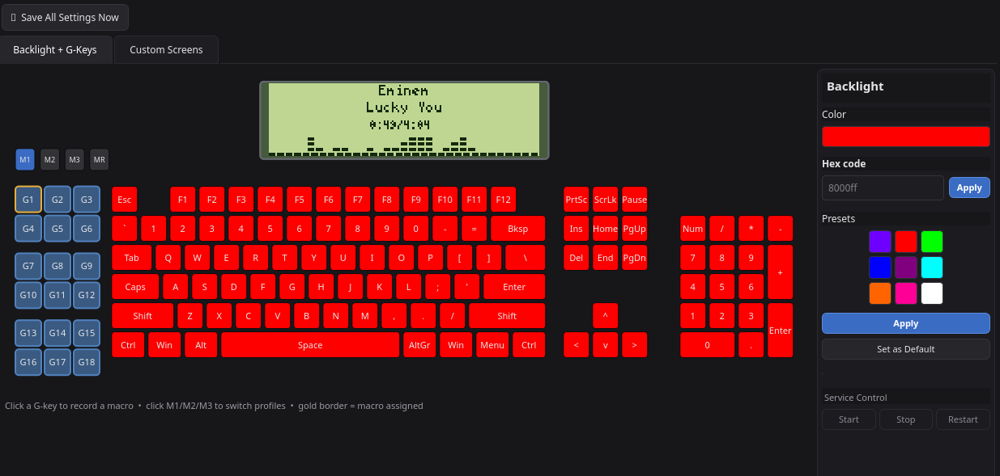
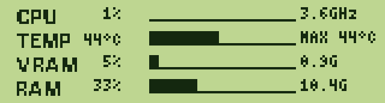
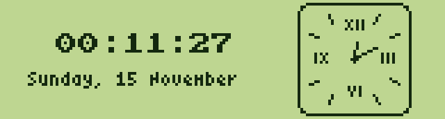
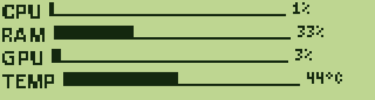
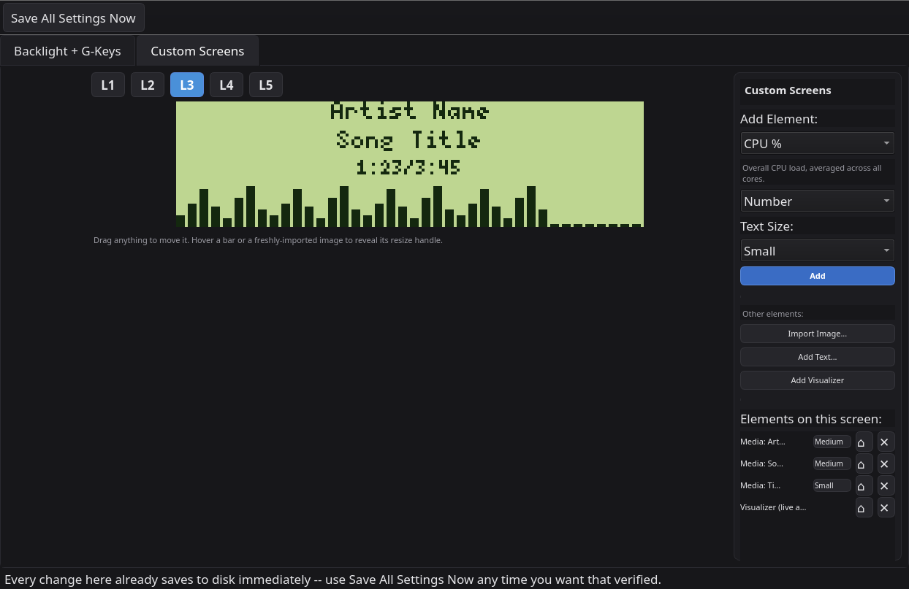
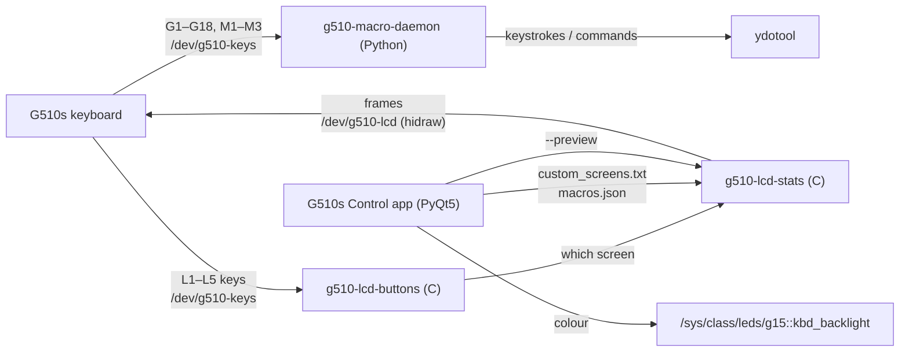

<div align="center">

# Logitech G510s for Linux

**The LCD screen, RGB backlight and G-key macros of the Logitech G510 / G510s, properly working on Linux.**




</div>

---

## Why

Logitech's own software is Windows-only and everything else out there
is old, abandoned or half-broken, so this talks to the keyboard
directly.

It writes the LCD through a `hidraw` device the kernel's own
`hid-lg-g15` driver already owns, instead of detaching the keyboard's
extra-keys interface the way g15daemon does. So media and volume keys
keep working exactly as before while the LCD runs (details in
[`G510_README.md`](G510_README.md#why-this-doesnt-use-g15daemon--libg15s-own-device-code)).

## Features

| | |
|---|---|
| 📊 **Live stats on the LCD** | CPU, RAM, VRAM and temperature on the stats screen, plus a digital and analog clock. L1 switches between the two |
| 🧩 **Custom screens (L2–L5)** | Drag sensors, images, text and a visualizer onto four screens of your own, in a live editor that shows exactly what the LCD will |
| 🎵 **A little Winamp on your keyboard** | Equalizer bars for whatever's playing, plus the song title, artist and elapsed time |
| 🌡️ **Sensors found by driver name** | AMD, Intel, NVIDIA, VIA, ARM CPUs; AMD, NVIDIA and Intel Arc GPUs; most motherboard sensor chips. Anything missing shows `N/A` |
| 🌈 **RGB backlight** | Colour presets or a hex code, Apply or Set as Default; restored at every login and every replug |
| ⌨️ **G-key macros** | G1–G18 on three profiles (M1/M2/M3): recorded keystrokes or shell commands, replayed through `ydotool` |
| 🔌 **Survives unplugging** | The keyboard drops off USB whenever its headset jack is plugged or unplugged; everything reconnects on its own |
| 🪶 **Light on the system** | Audio capture and song lookups run only while a screen that shows them is on the LCD |
| 👤 **Runs as your normal user** | The app and three small `systemd --user` services that start at login. `sudo` is only needed to install |
| 🌀 **Optional fan sensors** | Any program that writes `/run/fanpilot/sensors.tsv` (such as the separate FanPilot fan-control app) adds its sensors, fan RPM and duty to the editor |

## Screenshots

Every LCD image below was rendered by the real LCD program
(`g510_lcd_stats --preview`, the same drawing code that drives the
keyboard), shown at 4× size.

<table>
<tr>
<td></td>
<td></td>
</tr>
<tr>
<td align="center"><sub>L1: the stats screen</sub></td>
<td align="center"><sub>L1 again: digital and analog clock</sub></td>
</tr>
<tr>
<td></td>
<td></td>
</tr>
<tr>
<td align="center"><sub>A custom screen: media info and the visualizer</sub></td>
<td align="center"><sub>A custom screen: sensors as bars</sub></td>
</tr>
<tr>
<td colspan="2"></td>
</tr>
<tr>
<td colspan="2" align="center"><sub>The Custom Screens editor: pick L2–L5, add elements, drag them on the preview</sub></td>
</tr>
</table>

## Install

```
git clone https://github.com/grumpybollocks/Logitech-G510s-LCD-control.git
cd Logitech-G510s-LCD-control
./install.sh
```

The installer goes through 8 steps and prints `[ok]` or `[missing]` for
every item as it goes, installing only what's missing; it builds the LCD programs, converts the label
fonts, sets up the udev rules and services, and adds desktop
shortcuts. It asks for your `sudo` password once, and for one
unplug/replug of the keyboard so the new rules take effect
(`./install.sh --yes` skips waiting for the replug). Run it as your
normal user, not with `sudo`. Safe to re-run any time.

**Check it worked:**

```
systemctl --user status g510-lcd-stats g510-lcd-buttons g510-macro-daemon
```

All three should say `active (running)`. If the LCD stays blank,
unplug and replug the keyboard once.

**Desktop shortcuts** (on the desktop and in the app menu):
*G510 LCD - App*, *Start* (restarts the three services and tells you
if any isn't running), *View Logs*, *Rebuild* and *Project Folder*.

### What your PC needs

| | |
| --- | --- |
| **Linux** | See [Which Linux](#which-linux) below — Arch and Ubuntu are tested. |
| **Keyboard** | Logitech G510 or G510s, with or without a headset plugged in. |
| **Kernel** | A recent one: the keyboard uses the kernel's own `hid-lg-g15` driver, and colour control needs `/sys/class/leds/g15::kbd_backlight/multi_intensity` (developed on 7.x). |
| **Permissions** | Your user in the `input` group. The installer adds you if needed — log out and back in afterwards. |
| **Audio** | PipeWire (with `pipewire-pulse`) for the visualizer. |
| **Desktop** | Anything (KDE, GNOME, Xfce…): the shortcuts open whatever terminal and file manager you have. |

### Which Linux

| Linux | Status |
| --- | --- |
| **Arch family** — Arch, Manjaro, EndeavourOS, Garuda, CachyOS… | ✅ Tested (daily use). Needs an AUR helper (`yay` or `paru`) — install one first. |
| **Ubuntu 24.04** | ✅ Tested end to end on a fresh install: installer, services, a real macro keystroke, after a reboot. |
| Other **Debian family** — Debian, Mint, Pop!_OS… | Should work (same steps as Ubuntu), not tested yet. |
| **Fedora**, **openSUSE** | The installer tries the same steps with `dnf`/`zypper` — not tested yet. Reports welcome. |

Where a distro doesn't package something, the installer builds it from
the exact release Arch uses, and refuses to if the download's checksum
doesn't match. These go to `/usr/local` and never replace distro files:

- **`libg15` + `libg15render` 1.3.1** (the LCD library) — everywhere except Arch, where they come from the AUR.
- **`ydotool` 1.0.4** — only if the distro's is too old to replay macros
  (Ubuntu 24.04 ships 0.1.8, which can't). It also adds ydotool's user
  service and `/dev/uinput` access when the distro doesn't ship them.

What the installer adds, and why:

| Needed for | Arch package | Ubuntu/Debian package |
| --- | --- | --- |
| the app, image import, reading the G-keys | `python-pyqt5`, `python-pillow`, `python-evdev` | `python3-pyqt5`, `python3-pil`, `python3-evdev` |
| replaying macro keystrokes | `ydotool` | built from source (see above) |
| the LCD's label font | `freetype2` | `libfreetype-dev` |
| song title / artist / time | `playerctl` | `playerctl` |
| the audio visualizer | `libpulse` (`parec`) | `pulseaudio-utils` |
| building the C programs | `base-devel`, `pkgconf` | `build-essential`, `pkg-config`, `libusb-dev`, `cmake` |
| the LCD drawing library | `libg15`, `libg15render` (AUR) | built from source (see above) |

Optional: `zenity` gives the Start shortcut a proper dialog; without it you
get a desktop notification or a small Qt window instead.

**System files it puts in place** (with `sudo`): the udev rule in
`udev/99-g510-lcd.rules` (stable `/dev/g510-lcd` and `/dev/g510-keys`
links, backlight access for the `input` group) and a hwdb remap,
`udev/91-g510-stop-to-playpause.hwdb`, that makes the keyboard's
**Stop** media key send **Play/Pause**. To get the real Stop key back,
delete `/etc/udev/hwdb.d/91-g510-stop-to-playpause.hwdb` and run
`sudo systemd-hwdb update`.

## What happens when…

| Situation | What happens |
|---|---|
| You plug or unplug the headset jack (or the keyboard) | The keyboard re-enumerates as USB ID `046d:c22d` (no headset) or `046d:c22e` (headset); the udev rule matches both. The buttons listener and macro service reconnect in the same process (every 200 ms for 10 s, then every 3 s), no service restart needed |
| The LCD device is missing | The LCD program logs it once when it disappears and once when it's back, instead of on every frame |
| You reboot or log in | The three services start at login; the backlight colour is restored at login (`g510-backlight-restore`) and on every replug (udev) |
| No visualizer or media element is on screen | No audio capture and no `playerctl` calls at all |
| A media player hangs | Song lookups give up after 2 s instead of freezing the LCD and the L-buttons |
| A song title is too long | It is cut short with a `.` so it never runs off the 160 px screen; title and artist stay centred |
| A sensor doesn't exist on your PC | That reading shows `N/A`; everything else keeps working |
| The bundled label font is missing or damaged | A second bundled font is used, then the LCD library's built-in font. The LCD always starts |
| `macros.json` is damaged | It is copied aside (`macros.json.broken-<time>`) before anything is saved, and the app tells you where; macros that could be read are kept |
| Something unexpected goes wrong in the app | The error is logged and shown once; the app keeps running |
| The root-run backlight script reads your colour file | It only parses brightness and RGB numbers (0–255) and runs nothing from the file; it reads it as you, not as root |
| You re-run `./install.sh` | It only adds what's missing; it refuses to run as root |

## Tested

| Check | Result | Source |
|---|---|---|
| Automated tests (`tests/run-tests.sh`) | **194 checks in 11 suites, all passing.** Offscreen, scratch folders: never touches your keyboard or saved settings | one run of the suite |
| Daily use | Arch family, on the developer's own G510s | this README |
| Ubuntu 24.04 | Fresh VM for every round: installer exits 0, all services active with 0 restarts after re-login, a real macro keystroke (Ctrl+C) arrives, everything comes back after a reboot | PR #10, #11 |
| Memory (the LCD service) | Overnight soak of the live service: **9 h 18 m, RSS flat at 5,532 KB**, 0 restarts. `scripts/leak-check.sh` guards against the old FreeType leak | PR #1 |
| System impact | On the stats screen: no audio capture process and no extra CPU from child processes | PR #4 |
| Sanitizers | ASan + UBSan: 0 reports on the C tests and every `--preview` screen | PR #7, #13 |
| Rendering | LCD output compared pixel by pixel before and after changes (`--preview`) | PR #7, #13, #15 |
| Sensors | AMD hardware checked on a real machine; Intel, NVIDIA and the rest covered by tests against simulated sensor trees | [Sensors](#sensors-what-shows-up-on-which-hardware) |

## Sensors: what shows up on which hardware

Sensors are found by driver name, so most PCs need no setup. To see
what was picked on yours:

```
src/g510_lcd_stats --sensors
```

| LCD reading | Works on | Otherwise |
| --- | --- | --- |
| CPU temp | AMD (`k10temp`, `zenpower`, older `k8temp`), Intel (`coretemp`), VIA (`via_cputemp`), ARM / Raspberry Pi (`cpu_thermal`); falls back to the `x86_pkg_temp` thermal zone | N/A |
| GPU temp | AMD (`amdgpu`, `radeon`), NVIDIA proprietary driver (via NVML), NVIDIA `nouveau`, Intel Arc (`xe`) | N/A — Intel integrated graphics have no temperature sensor |
| GPU hotspot temp | AMD (`amdgpu`) | N/A |
| GPU VRAM temp | AMD (`amdgpu`), Intel Arc (`xe`) | N/A |
| GPU load, VRAM used | AMD (`amdgpu`), NVIDIA proprietary driver | N/A |
| Motherboard temps (`MB_TEMP1`–`8`) | Gigabyte (`gigabyte_wmi`), ASUS (`asus_wmi_sensors`, `asus-ec-sensors`, older boards `atk0110`), most other boards via their Nuvoton `nct67xx`/`nct66xx`, ITE `it87xx`, Winbond or Fintek (`f71xxx`/`f8xxx`) chip, SMSC/Fujitsu (`sch5627`, `sch5636`); Dell (`dell_smm`), ThinkPad, HP (`hp_wmi_sensors`) | N/A |
| CPU load/clock, RAM, swap, disk, network, uptime, media | every Linux PC | — |

- **Two graphics cards** (e.g. a Ryzen APU plus a real card): the one
  with the most VRAM is used; with several NVIDIA cards, the first.
- **NVIDIA:** its driver has no Linux sensor files, so readings come
  from `libnvidia-ml` (ships with the driver), loaded only when an
  NVIDIA driver is running.
- **Laptops with a switchable GPU:** a sleeping GPU is left asleep and
  shows N/A instead of being woken up.
- **Motherboard sensors missing?** Many boards need their sensor driver
  loaded: run `sudo sensors-detect` (from `lm_sensors`) and load what it
  suggests, often `sudo modprobe nct6775`. Some ITE chips need the
  out-of-tree `it87` driver from the AUR.
- So far only AMD hardware has been checked on a real machine. Intel,
  NVIDIA and the rest are covered by tests against simulated sensor
  trees. Reports from other hardware are welcome — include the
  `--sensors` output.

### Optional: FanPilot sensors (fan speeds and more)

Nothing changes unless you also run **FanPilot**, a separate fan-control app (not part of
this repo). If it's running, the **Custom Screens** sensor dropdown also lists everything
FanPilot knows, under FanPilot's own names:

- every temperature it shows (CPU, CPU die, GPU edge/hotspot/memory, VRM, chipset,
  NVMe...), labelled by what it measures instead of `MB_TEMP3`;
- the **speed (RPM)** of every fan, and its **duty %** while FanPilot controls it.

They appear as **"FanPilot: …"** at the end of the list and draw on the LCD with a short
label (`CPU`, `VRM`, `SYS1`, `GPUF`, ...). Temperatures and percentages can be bars;
RPM is a number.

How it works: FanPilot rewrites `/run/fanpilot/sensors.tsv` once a second (in RAM, no
disk writes); the LCD program and the app read that file. If FanPilot is stopped or not
installed, those elements show **N/A** and everything else works exactly as before.
`src/g510_lcd_stats --sensors` lists what FanPilot currently offers.

The file is plain text, so any other program can feed the LCD the same way: a header line
`# fanpilot-sensors 1 <unix time>`, then one line per sensor with five tab-separated fields
— `key`, `kind` (`temp` / `rpm` / `pct`), a short label (max 4 characters), a long label,
and the value (empty if unknown). It must be rewritten at least every 15 seconds.

## Custom screens

L1 is built in (stats ⇄ clock). **L2–L5 are yours**: open the app's
**Custom Screens** tab, pick a screen and add:

- **sensors**, as a **Number** or a **Bar** (bars only for readings with
  an honest 0–100 % or temperature range), in up to four text sizes;
- **text** labels;
- **images** — any picture is shrunk and converted for the 1-bit
  screen; flat, high-contrast logos work best;
- one **visualizer**.

Drag anything on the preview to move it; hover a bar's end or an
image's corner to resize it. Every change saves itself instantly — no
Save button needed. Per screen: up to 8 sensors, 2 images, 4 text
fields and 1 visualizer. The screen is 160×43 pixels, and the preview
is drawn by the same code as the real LCD, so what you see is what the
keyboard shows. Full walkthrough:
[`G510_CUSTOM_SCREENS_HOWTO.md`](G510_CUSTOM_SCREENS_HOWTO.md).

## The audio visualizer

Drop a visualizer onto any of L2–L5 and the LCD becomes a tiny live
equalizer next to the song title, artist and a running `1:23/3:45`.

It doesn't hook into any particular app: it listens to whatever is
coming out of your speakers, like a real VU meter. So it works the same
with Spotify, a YouTube tab, VLC or a game, with nothing to configure.
Make it bigger and it adds more bars rather than fatter ones.

It only listens while a screen with a visualizer is actually on the
LCD; on the stats or clock screen the audio capture and song lookups
stop completely.

## How it works



Three small programs run as systemd `--user` services:

| Service | Does |
| --- | --- |
| `g510-lcd-stats` (C) | draws every LCD screen and sends it to `/dev/g510-lcd` |
| `g510-lcd-buttons` (C) | listens to L1–L5 on `/dev/g510-keys` and switches screens |
| `g510-macro-daemon` (Python) | listens to G1–G18 and M1–M3 and replays macros through `ydotool` |

The app (`src/g510_app.py`) is the editor: backlight, macros and the
Custom Screens builder. Its previews are rendered by the same C
program that drives the LCD, so they match the real screen pixel for
pixel.

`/dev/g510-lcd` and `/dev/g510-keys` are stable links made by the udev
rule in `udev/`, not device numbers that change between boots. The
keyboard drops off USB and comes back whenever its headset jack is
plugged or unplugged; everything reconnects on its own.

Your own settings (custom screens, imported images, macros, boot
colour) live in `~/.local/share/g510-lcd`, not in the checkout.

Run the tests with `tests/run-tests.sh` — nothing in them touches your
keyboard or your saved settings.

## Status

- Public, MIT-licensed, in daily use on the developer's own G510s.
- Changes land on `main` through pull requests and are confirmed on
  the real keyboard.
- Not on the AUR yet (a PKGBUILD lives in `packaging/`).

## Docs

- [`docs/index.html`](docs/index.html) — the project's landing page.
- [`G510_README.md`](G510_README.md) — the full story: protocol
  details, every bug hit and fixed, fonts, udev rules.
- [`G510_CUSTOM_SCREENS_HOWTO.md`](G510_CUSTOM_SCREENS_HOWTO.md) — how
  to use the Custom Screens editor.
- [`READY_FOR_ANYONE.md`](READY_FOR_ANYONE.md) — why nothing in the
  install is tied to one machine or one checkout path.
- [`BRANCHES.md`](BRANCHES.md) — branch history.

**Looking for the G910?** That app moved to its own repo:
[grumpybollocks/g910-control](https://github.com/grumpybollocks/g910-control).

---

## The cheeky bits

- The LCD can show free space on a second drive like any other sensor —
  fully optional, and it shows "N/A" gracefully if you don't have one.
- This started out sharing a repo with the G910 app before the two
  split; that history still lives in this repo's commit log.
- "wtf are the blue squares for?" is genuine, verbatim user feedback
  that shipped a real UI fix (resize handles now only appear when you
  hover near them) — real usage beats guessing every time.

## License

[MIT](LICENSE).
